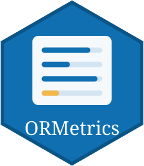

# ORMetrics 

The R counterpart of the [OpenResearchMetrics web tool](https://pablosancheznunez.com/openresearchmetrics/): transparent open science indicators for responsible research assessment. Each indicator is reported on its own, with its evidence, the sources consulted and its limits. **There is no composite score**, and an indicator that cannot be verified is `unverifiable`, never zero.

Status: **prototype**. The engine is checked against the web tool's regression report; the package has not been released.

```r
# install.packages("remotes")
remotes::install_github("pablosancheznunez/openresearchmetrics", subdir = "r")

library(ORMetrics)
report <- orm_assess("0000-0002-1825-0097")   # OpenAlex, DataCite, OpenAIRE
report
as.data.frame(report)

# Offline, with recorded responses:
ex <- orm_example_evidence()
orm_compute(ex$evidence, ex$consulted)
```

The catalogue (`orm_catalog()`), the recorded responses and the expected report are byte-for-byte copies of the web tool's files; CI fails if they drift apart. Changes to the catalogue, the engine or the expected report need the maintainer's review.
